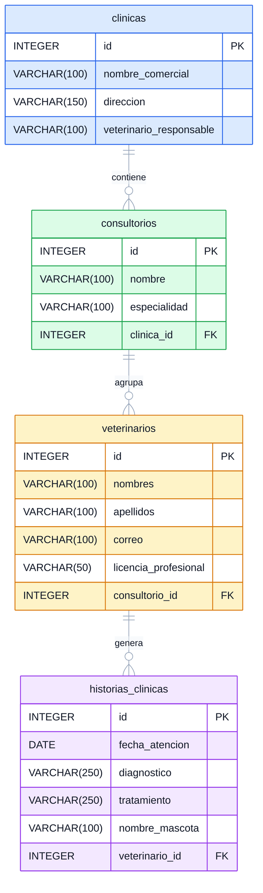

# Sistema de gestión de clínicas veterinarias

## Información académica

- Universidad: Universidad Técnica Particular de Loja (UTPL)
- Carrera: Ingeniería en Tecnologías de la Información
- Asignatura: Desarrollo Basado en Plataformas Web
- Actividad: APEB1 - AE1
- Estudiante: Paul Andrés Zavala Palomeque
- Período académico: Octubre 2026 - Febrero 2027

## Descripción del proyecto

El proyecto implementa un sistema de gestión de una red de clínicas
veterinarias mediante Python, SQLite y SQLAlchemy ORM.

Permite almacenar y consultar información de clínicas, consultorios,
veterinarios e historias clínicas de las mascotas atendidas.

## Tecnologías utilizadas

- Python 3.13
- SQLAlchemy ORM
- SQLite
- Visual Studio Code
- Git y GitHub

## Modelo de datos

El sistema está compuesto por cuatro entidades relacionadas:

- Clinica
- Consultorio
- Veterinario
- HistoriaClinica

Las entidades mantienen relaciones de uno a muchos (1:N):

Clinica -> Consultorio -> Veterinario -> HistoriaClinica

## Estructura del proyecto

| Archivo | Descripción |
|---|---|
| configuracion.py | Configuración de la base de datos |
| crear_base_entidades.py | Definición y creación de entidades |
| poblar_base.py | Ingreso de datos de ejemplo |
| consulta_all.py | Consulta general y conteo de historias clínicas por clínica |
| consulta_filter.py | Consultas mediante filtros |
| consulta_order_by.py | Consultas ordenadas |
| consulta_or.py | Consultas con operador OR |
| consulta_and.py | Consultas con operador AND |
| veterinaria.db | Base de datos SQLite |
| .gitignore | Exclusión de archivos temporales |

## Instalación de dependencias

```bash
python -m pip install sqlalchemy
```

## Ejecución del proyecto

Crear la base de datos e ingresar la información:

```bash
python crear_base_entidades.py
python poblar_base.py
```

Ejecutar las consultas:

```bash
python consulta_all.py
python consulta_filter.py
python consulta_order_by.py
python consulta_or.py
python consulta_and.py
```

## Resultados obtenidos

La base de datos contiene 17 registros de ejemplo:

| Entidad | Registros |
|---|---:|
| Clínicas | 3 |
| Consultorios | 4 |
| Veterinarios | 4 |
| Historias clínicas | 6 |
| Total | 17 |

### Historias clínicas por clínica

| Clínica | Ciudad | Historias clínicas |
|---|---|---:|
| VetCare | Cuenca | 3 |
| Animal Health | Loja | 2 |
| PetLife | Machala | 1 |
| Total | | 6 |

## Conclusión

La implementación permite aplicar los conceptos de mapeo
objeto-relacional mediante SQLAlchemy, establecer relaciones entre
entidades y realizar consultas sobre una base de datos SQLite,
cumpliendo los requerimientos planteados en la actividad académica.

Los datos utilizados son ficticios y tienen fines educativos.
## Modelo relacional de la base de datos

El siguiente diagrama representa las cuatro entidades
del sistema de clínicas veterinarias, sus atributos,
claves primarias, claves foráneas y relaciones
de uno a muchos (1:N).

