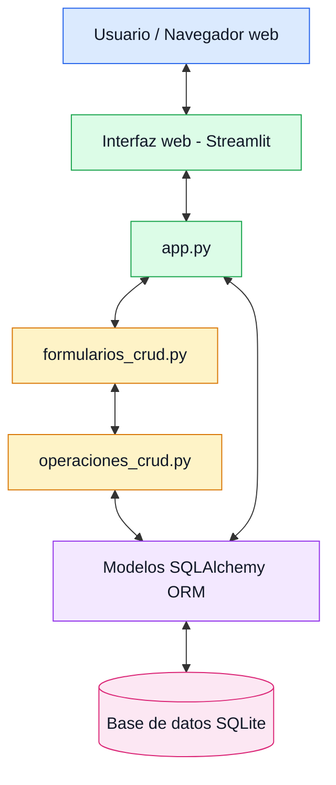
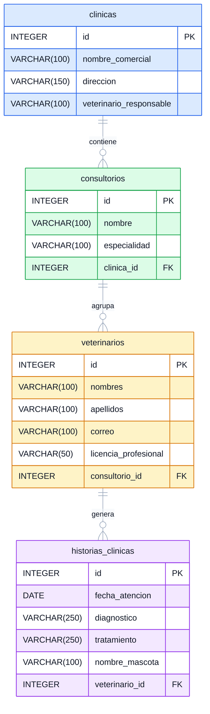
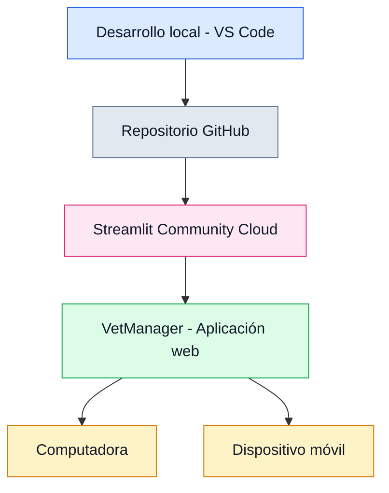

# 🐾 VetManager 2.0
### Sistema web de gestión de clínicas veterinarias


---

## 🌐 Aplicación web

VetManager se encuentra desplegado en Streamlit Community Cloud y permite acceder al sistema desde un navegador web, sin necesidad de instalar programas adicionales.

**Acceder a VetManager:**

https://vetmanager-utpl-pzavala.streamlit.app/

**Repositorio del proyecto:**

https://github.com/paulzp-zavala/ae1bim-oct26-feb27

---

## 🎓 Información académica

| Información | Detalle |
|---|---|
| Universidad | Universidad Técnica Particular de Loja (UTPL) |
| Carrera | Ingeniería en Tecnologías de la Información |
| Asignatura | Desarrollo Basado en Plataformas Web |
| Docente | René Elizalde |
| Actividad | APEB1 - AE1 |
| Estudiante | Paul Andrés Zavala Palomeque |
| Período académico | Octubre 2026 - Febrero 2027 |

---

## 📖 Descripción del proyecto

VetManager es un sistema web desarrollado para gestionar una red de clínicas veterinarias ubicadas en diferentes ciudades.

El proyecto utiliza Python, SQLite y SQLAlchemy ORM para implementar un modelo de datos orientado a objetos, permitiendo establecer relaciones entre clínicas, consultorios, veterinarios e historias clínicas.

Como complemento a los requerimientos de la actividad académica, se desarrolló una interfaz web interactiva mediante Streamlit, incorporando operaciones CRUD, consultas avanzadas, indicadores estadísticos y visualización gráfica de la información.

La aplicación permite gestionar los registros desde computadoras y dispositivos móviles mediante un navegador web.

---

## 🎯 Objetivos

- Aplicar los conceptos de programación orientada a objetos.
- Implementar el mapeo objeto-relacional mediante SQLAlchemy ORM.
- Diseñar una base de datos relacional utilizando SQLite.
- Establecer relaciones entre las entidades del sistema.
- Implementar consultas mediante all(), filter(), order_by(), or_() y and_().
- Desarrollar una interfaz web interactiva para gestionar la información.
- Implementar operaciones CRUD.
- Publicar la aplicación en un entorno de alojamiento en la nube.

---

## 🚀 Funcionalidades principales

### Panel general

- Indicadores dinámicos de clínicas.
- Indicadores de consultorios.
- Indicadores de veterinarios.
- Indicadores de historias clínicas.
- Gráfico de barras por establecimiento.
- Gráfico circular de distribución de historias clínicas.
- Resumen estadístico por clínica.

### Gestión de clínicas

- Registrar nuevas clínicas.
- Consultar registros existentes.
- Editar información.
- Eliminar registros sin dependencias.
- Buscar clínicas registradas.

### Gestión de consultorios

- Registrar consultorios.
- Asignar consultorios a clínicas.
- Consultar y editar información.
- Eliminar registros sin dependencias.

### Gestión de veterinarios

- Registrar profesionales.
- Asignar veterinarios a consultorios.
- Gestionar información profesional.
- Consultar, editar y eliminar registros.

### Gestión de historias clínicas

- Registrar atenciones veterinarias.
- Identificar la mascota atendida.
- Registrar fechas, diagnósticos y tratamientos.
- Asociar historias clínicas con veterinarios.
- Consultar, editar y eliminar registros.

### Consultas avanzadas

La aplicación incorpora un módulo interactivo que permite ejecutar consultas mediante SQLAlchemy ORM y visualizar sus resultados.

| Método | Funcionalidad |
|---|---|
| all() | Recuperar todos los objetos de una entidad |
| filter() | Filtrar registros mediante condiciones |
| order_by() | Ordenar registros por atributos |
| or_() | Consultar registros que cumplen al menos una condición |
| and_() | Consultar registros que cumplen simultáneamente varias condiciones |

---

## 🛠️ Tecnologías utilizadas

| Tecnología | Aplicación en el proyecto |
|---|---|
| Python 3.13 | Lenguaje de programación |
| SQLAlchemy ORM | Mapeo objeto-relacional |
| SQLite | Base de datos relacional |
| Streamlit | Desarrollo de la interfaz web |
| Pandas | Organización y visualización de datos |
| Altair | Generación de gráficos estadísticos |
| HTML | Personalización de elementos visuales |
| CSS | Diseño y personalización de la interfaz |
| Mermaid | Diagramas de arquitectura y modelo relacional |
| Visual Studio Code | Entorno de desarrollo |
| Git | Control de versiones |
| GitHub | Alojamiento del código fuente |
| Streamlit Community Cloud | Despliegue de la aplicación web |

---

## 🏗️ Arquitectura del sistema

La aplicación separa la presentación, la lógica de gestión y la persistencia de datos, facilitando el mantenimiento y la organización del código.



### Capa de presentación

Implementada mediante Streamlit, HTML y CSS. Permite interactuar con formularios, tablas, gráficos y consultas.

### Capa de lógica de gestión

Implementada mediante Python. Contiene las operaciones CRUD, validaciones y reglas de gestión de registros relacionados.

### Capa de persistencia

Implementada mediante SQLAlchemy ORM y SQLite. Permite almacenar, consultar, actualizar y eliminar información mediante objetos Python.

---

## 🗄️ Modelo de datos

El sistema está compuesto por cuatro entidades relacionadas:

- Clinica
- Consultorio
- Veterinario
- HistoriaClinica

Las entidades mantienen relaciones de uno a muchos (1:N):

Clinica → Consultorio → Veterinario → HistoriaClinica

Cada consultorio pertenece a una clínica, cada veterinario pertenece a un consultorio y cada historia clínica se encuentra asociada al veterinario responsable de la atención.

---

## 📐 Modelo relacional de la base de datos

El siguiente diagrama representa las cuatro entidades del sistema, sus atributos, claves primarias, claves foráneas y relaciones.



---

## 🔄 Operaciones CRUD

VetManager permite realizar las cuatro operaciones fundamentales para la gestión de información.

| Operación | Significado | Funcionalidad |
|---|---|---|
| CREATE | Crear | Registrar nuevos objetos |
| READ | Leer | Consultar registros existentes |
| UPDATE | Actualizar | Modificar atributos de los objetos |
| DELETE | Eliminar | Eliminar registros permitidos |

Las operaciones se realizan mediante SQLAlchemy ORM, utilizando objetos Python y sesiones de base de datos.

### Validación de relaciones

La aplicación incorpora reglas de protección para evitar la eliminación de registros que mantienen dependencias.

- No permite eliminar clínicas con consultorios asociados.
- No permite eliminar consultorios con veterinarios asociados.
- No permite eliminar veterinarios con historias clínicas asociadas.
- Solicita confirmación antes de eliminar un registro.

Estas validaciones contribuyen a mantener la consistencia de la información desde la aplicación.

---

## 📂 Estructura del proyecto

| Archivo o carpeta | Descripción |
|---|---|
| configuracion.py | Configuración de la conexión a SQLite |
| crear_base_entidades.py | Definición de clases, atributos y relaciones ORM |
| poblar_base.py | Ingreso de datos iniciales de ejemplo |
| consulta_all.py | Consulta general y conteo de historias clínicas por clínica |
| consulta_filter.py | Consultas mediante filtros |
| consulta_order_by.py | Consultas ordenadas |
| consulta_or.py | Consultas con operador OR |
| consulta_and.py | Consultas con operador AND |
| app.py | Aplicación web principal |
| operaciones_crud.py | Lógica de operaciones CRUD |
| formularios_crud.py | Formularios de gestión de las entidades |
| assets/ | Recursos y estilos visuales |
| .streamlit/config.toml | Configuración visual de Streamlit |
| requirements.txt | Dependencias del proyecto |
| veterinaria.db | Base de datos SQLite |
| .gitignore | Exclusión de archivos temporales |
| README.md | Documentación del proyecto |

---

## ⚙️ Instalación y ejecución local

### 1. Clonar el repositorio

```bash
git clone https://github.com/paulzp-zavala/ae1bim-oct26-feb27.git
```

### 2. Ingresar al directorio del proyecto

```bash
cd ae1bim-oct26-feb27
```

### 3. Instalar las dependencias

```bash
python -m pip install -r requirements.txt
```

### 4. Inicializar la base de datos

El repositorio incluye una base de datos SQLite con registros de ejemplo.

En caso de necesitar generar una base de datos nueva, ejecutar los siguientes archivos sobre una base vacía:

```bash
python crear_base_entidades.py
python poblar_base.py
```

No es necesario ejecutar nuevamente el archivo de población si se utiliza la base de datos incluida en el repositorio.

### 5. Ejecutar las consultas académicas

```bash
python consulta_all.py
python consulta_filter.py
python consulta_order_by.py
python consulta_or.py
python consulta_and.py
```

### 6. Ejecutar VetManager

```bash
python -m streamlit run app.py
```

Abrir la siguiente dirección en el navegador:

http://localhost:8501

---

## 📊 Resultados obtenidos

Durante la implementación inicial se registraron 17 elementos de ejemplo.

| Entidad | Registros iniciales |
|---|---:|
| Clínicas | 3 |
| Consultorios | 4 |
| Veterinarios | 4 |
| Historias clínicas | 6 |
| **Total** | **17** |

### Distribución inicial de historias clínicas

| Clínica | Ciudad | Historias clínicas |
|---|---|---:|
| VetCare | Cuenca | 3 |
| Animal Health | Loja | 2 |
| PetLife | Machala | 1 |
| **Total** | | **6** |

Posteriormente, durante las pruebas de la interfaz web, se incorporaron nuevos registros para comprobar el funcionamiento de las operaciones CRUD y las relaciones entre entidades.

Los indicadores del panel general se actualizan dinámicamente según la información almacenada en la base de datos.

---

## 🧪 Pruebas de funcionamiento

Se realizaron pruebas en el entorno local y en la aplicación publicada en Internet.

| Prueba | Resultado |
|---|---|
| Creación de la base de datos | Satisfactorio |
| Población de registros | Satisfactorio |
| Consultas SQLAlchemy ORM | Satisfactorio |
| Registro de nuevas entidades | Satisfactorio |
| Consulta de información | Satisfactorio |
| Actualización de registros | Satisfactorio |
| Eliminación de registros permitidos | Satisfactorio |
| Protección de registros relacionados | Satisfactorio |
| Actualización de indicadores | Satisfactorio |
| Visualización de gráficos | Satisfactorio |
| Despliegue en Streamlit Cloud | Satisfactorio |
| Acceso desde computadora | Satisfactorio |
| Acceso desde dispositivo móvil | Satisfactorio |

---

## ☁️ Despliegue en la nube

La aplicación fue publicada mediante Streamlit Community Cloud, utilizando GitHub como repositorio del código fuente.



### Configuración del despliegue

| Parámetro | Configuración |
|---|---|
| Plataforma | Streamlit Community Cloud |
| Rama | main |
| Archivo principal | app.py |
| Versión de Python | 3.13 |
| Dependencias | requirements.txt |
| Base de datos | SQLite |

---

## ⚠️ Consideraciones del entorno de demostración

VetManager es un proyecto académico desarrollado con datos ficticios.

La aplicación publicada no incorpora autenticación de usuarios y permite realizar operaciones CRUD con fines demostrativos.

Debido a las características del almacenamiento local en Streamlit Community Cloud, los cambios realizados sobre SQLite podrían perderse al reiniciar o redesplegar la aplicación.

Para una implementación en producción sería necesario incorporar autenticación, autorización de usuarios, almacenamiento persistente, mecanismos de respaldo y controles adicionales de seguridad.

---

## 📝 Conclusión

El desarrollo de VetManager permitió aplicar los conceptos de programación orientada a objetos y mapeo objeto-relacional mediante SQLAlchemy ORM, implementando entidades relacionadas y operaciones de consulta sobre una base de datos SQLite.

La incorporación de Streamlit permitió ampliar el alcance del proyecto mediante una interfaz web interactiva, operaciones CRUD, consultas avanzadas y visualización dinámica de información.

Finalmente, el despliegue en la nube permitió integrar los conocimientos de desarrollo de software, bases de datos, control de versiones y plataformas web en una aplicación accesible desde diferentes dispositivos.

---

## 👨‍💻 Autor

**Paul Andrés Zavala Palomeque**

Ingeniería en Tecnologías de la Información

Universidad Técnica Particular de Loja

Desarrollo Basado en Plataformas Web

Octubre 2026 - Febrero 2027

---

**VetManager 2.0 | PAUL ANDRES ZAVALA PALOMEQUE | 2026**
